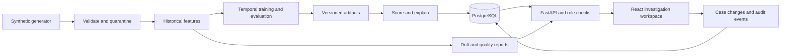

# Explainable Fraud Radar

A synthetic financial transaction investigation platform with a React workspace, FastAPI API, PostgreSQL persistence, reproducible ML pipeline and version-bound model explanations. Predictions prioritize human review; they do not establish fraud or trigger banking actions.

## What is included

- Seeded synthetic transactions with overlapping legitimate and suspicious patterns.
- Validation, duplicate protection, quarantine, chronological historical features and pipeline history.
- Rules, Logistic Regression, Random Forest and Isolation Forest comparisons using chronological holdouts.
- Exact additive logistic explanations in log-odds, separate rule scores and anomaly percentiles.
- Transaction search, risk filtering, case assignment, notes, escalation, confirmed disposition and audit history.
- Threshold analysis, statistical drift monitoring, model registry and explicit model activation.
- Password hashing, signed expiring tokens, backend role checks, restricted CORS and request IDs.
- Alembic migrations, container deployment, automated tests and CI configuration.

See [acceptance evidence](docs/acceptance.md) and [verification report](reports/verification.md) for what has actually been executed. This is a portfolio demonstration, not a certified financial production system.

## Quick start — Windows with Docker Desktop

Prerequisites: Docker Desktop running Linux containers, PowerShell, and an available local port 8087. First build downloads dependencies and can take several minutes.

```powershell
.\scripts\configure.ps1
docker compose up -d --build
docker compose exec backend python -m backend.app.cli seed --transactions 3000 --seed 42
```

Open [the local application](http://localhost:8087). Read `BOOTSTRAP_USERNAME` and `BOOTSTRAP_PASSWORD` from the generated local `.env` to sign in. Credentials are unique to your checkout; do not share or commit that file. Configuration refuses to overwrite an existing `.env`.

The API migrates the database and initializes the administrator on startup. Seed explicitly after startup; before seeding, readiness correctly reports that a model is needed. PostgreSQL and model artifacts live in named volumes. `docker compose down` stops services while preserving data; deleting volumes destroys that data.

For Linux/macOS, copy `.env.example` to `.env`, replace all placeholder secrets with cryptographically random values, and run the same Docker commands. Do not use the example placeholders in a shared environment.

## Local development without containers

Requires Python 3.12 and Node.js 22.19 or later. SQLite is a convenience fallback; Docker uses PostgreSQL.

```powershell
python -m venv .venv
.\.venv\Scripts\python.exe -m pip install -r backend/requirements.txt
.\scripts\configure.ps1
.\.venv\Scripts\python.exe -m backend.app.cli init
.\.venv\Scripts\python.exe -m backend.app.cli seed --transactions 3000 --seed 42
.\.venv\Scripts\python.exe -m uvicorn backend.app.main:app --host 127.0.0.1 --port 8017
```

In another terminal:

```powershell
cd frontend
npm ci
npm run dev -- --port 5177 --strictPort
```

Open [the development UI](http://localhost:5177) and [interactive API documentation](http://localhost:8017/docs). Vite proxies `/api` to port 8017; `API_PROXY_TARGET` can override the target. Do not run `configure.ps1` again if `.env` already exists. Python configuration loads it automatically. The development server is for local use.

## Reproducible data and models

```powershell
# Initial application dataset, training, stored predictions and alerts
.\.venv\Scripts\python.exe -m backend.app.cli seed --transactions 3000 --seed 42

# Full standalone benchmark with raw/curated data and reproducible reports
.\.venv\Scripts\python.exe -m ml --transactions 100000 --customers 1000 --output reports/generated-100k
```

The offline command defaults to approximately 100,000 records. Its large outputs are ignored by Git. Small reports from the executed benchmark are retained in `reports/benchmark-100k`. A seed controls reproducibility; changing generator code or configuration changes the dataset. Re-ingesting the same transaction identifiers does not duplicate stored transactions.

Alert thresholds and descriptive risk bands are independent. A validation-selected alert threshold below 25 can create a case in the Low band; that case still requires human review under the selected workload policy.

Train/validation/test splits are chronological 60/20/20. Validation selects a review threshold subject to a capacity constraint. The displayed operational score is `100 × logistic probability`; anomaly percentile and rules remain separate context. Risk bands are configurable in the ML engine and are not industry standards. A new generated model is registered; subsequent activation is an explicit administrator action. Previous stored predictions retain their own model version.

## Tests and production build

```powershell
.\.venv\Scripts\python.exe -m pytest backend/tests -q
.\.venv\Scripts\python.exe -m ruff check backend ml
.\.venv\Scripts\python.exe -m ruff format --check backend ml
cd frontend
npm run build
npm run test:e2e
```

Browser tests require a running, seeded application and Playwright Chromium. See [testing instructions](docs/testing.md) for environment variables and execution evidence. CI also checks PostgreSQL integration and dependencies. A workflow file is not evidence that a remote GitHub run has occurred.

## Architecture and project map



`frontend/` contains the React/TypeScript UI, reusable components, charts and browser tests. `backend/` contains API routes, schemas, persistence, authorization, migrations and integration tests. `ml/` separates generation, validation, features, training, inference, evaluation, explanations and monitoring. `scripts/` holds local configuration helpers. `reports/` retains small reproducible evidence. Exact direct dependency pins live in `backend/requirements.txt` and `frontend/package.json`; npm's lockfile pins its dependency graph.

The stack uses Vite, Tailwind CSS, Recharts, TanStack Query, React Hook Form and Zod; FastAPI, Pydantic, SQLAlchemy and Alembic; NumPy, Pandas, scikit-learn, SciPy and joblib. Exact linear attribution is a model-appropriate alternative to SHAP. A local version registry replaces an MLflow service, and custom statistical monitoring replaces Evidently. A PostgreSQL-backed durable queue provides worker leases, retries and recovery without a Redis dependency. Local development must run `python -m backend.app.worker` in a separate terminal for API-submitted training jobs; Docker Compose starts it automatically.

## Documentation

- [Architecture and decisions](docs/architecture.md)
- [Data dictionary](docs/data_dictionary.md), [synthetic data card](docs/data_card.md)
- [ML methodology](docs/ml_methodology.md), [model card](docs/model_card.md)
- [API contract](docs/api.md), [database schema](docs/database.md)
- [Module and transaction walkthrough](docs/module_walkthrough.md)
- [Security boundaries](docs/security.md), [deployment runbook](docs/deployment.md)
- [Beginner glossary](docs/glossary.md), [interview and portfolio guide](docs/interview_guide.md)
- [Testing](docs/testing.md), [acceptance checklist](docs/acceptance.md)

Capture screenshots from the actual running overview, attribution and case-history pages. `reports/screenshots/` contains execution captures when available. No supplied Sentinel screenshot was attached with the text; the UI uses its own visual identity.

## Troubleshooting and limitations

- **Readiness says `needs_seed`:** run the seed command after migrations complete.
- **Login fails:** use the generated credentials in `.env`. Changing the bootstrap password after creating the account does not reset the stored password.
- **Port already in use:** change the frontend port binding or local Vite port; do not stop unrelated applications.
- **An ingestion batch rejects records:** inspect pipeline rejection counts and quarantine reasons; preserve high amounts rather than deleting them as outliers.
- **Windows tests hang in a restricted shell:** network/socket sandboxing can block FastAPI's test client. Run in an allowed terminal or Linux container.
- **Model loading fails:** restore the artifact matching the registered version. Never load untrusted joblib files.

Synthetic scenario design simplifies genuine banking behavior, and performance does not generalize to real institutions. Only LKR inputs are supported unless an explicit currency-normalization layer is added. Delayed verified outcomes and monitoring investigations are persisted independently of case opinions. Sessions are revocable and database triggers protect audit evidence from ordinary mutations. Identity federation, externally anchored audit storage, disaster recovery, deployment-specific retention policy, calibrated real-world models and independent security/regulatory assessment remain deployment responsibilities. See the verification report for additional concrete gaps.

No public deployment has been performed. See the runbook before proposing one.
