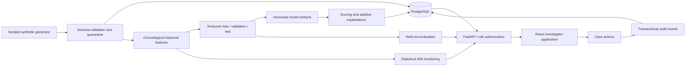

# Architecture and decisions

The browser calls versioned JSON endpoints through the same-origin reverse proxy. FastAPI validates inputs and checks the authenticated role before database changes. SQLAlchemy supports PostgreSQL in containers and SQLite for lightweight local verification. Alembic owns schema evolution. Model artifacts are local trusted files mounted on persistent storage; never load uploaded pickle/joblib artifacts.

The ML package separates generation, historical features, training, inference, evaluation, explanations and monitoring. Training uses time-ordered splits; labels and scenario names are evaluation metadata, never predictor inputs. Predictions and investigator decisions remain distinct records. Audit events accompany case mutations in the same transaction.

## Deliberate simplifications

Use exact additive logistic-regression attribution where it provides a faithful model-appropriate explanation. Its units are log-odds, not percentage points. The operational score is 100 times the logistic probability; anomaly percentiles and rule scores remain separate context. Random Forest and Isolation Forest provide comparative benchmarks. A filesystem registry provides local reproducibility. A separate worker consumes the durable database queue with leases, heartbeats and fenced commits; PostgreSQL serializes training ownership without a separate Redis broker.

This is a synthetic decision-support application. It neither contacts banks nor enforces account restrictions. Synthetic benchmark performance cannot establish real-world efficacy or regulatory readiness.
